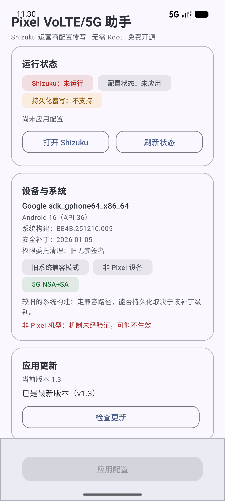
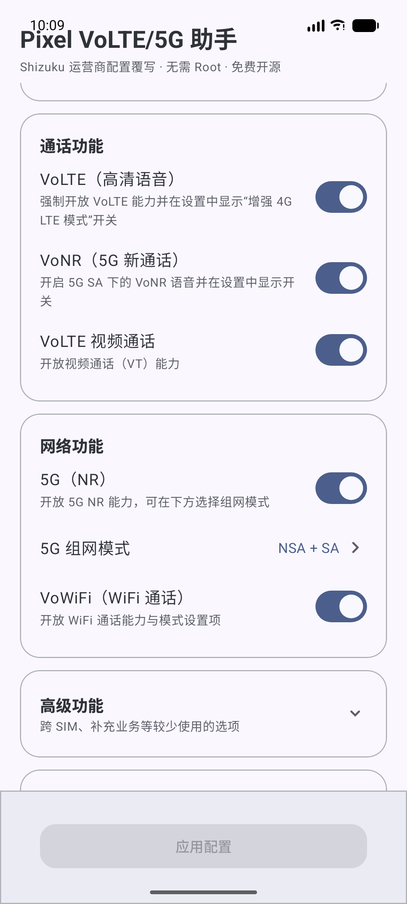
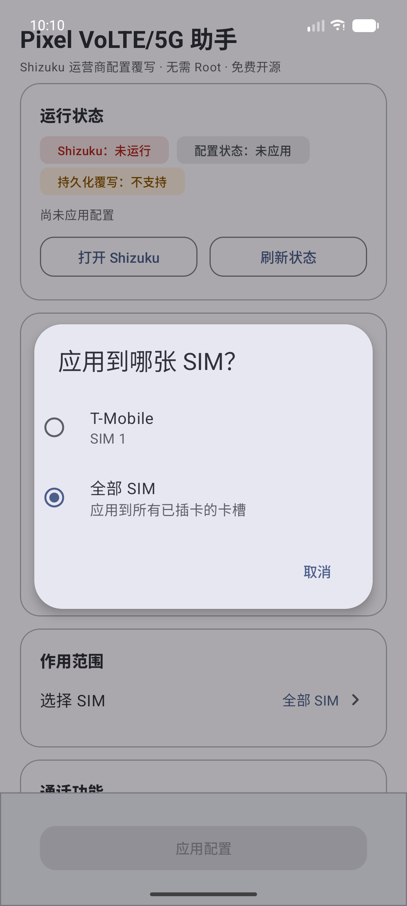
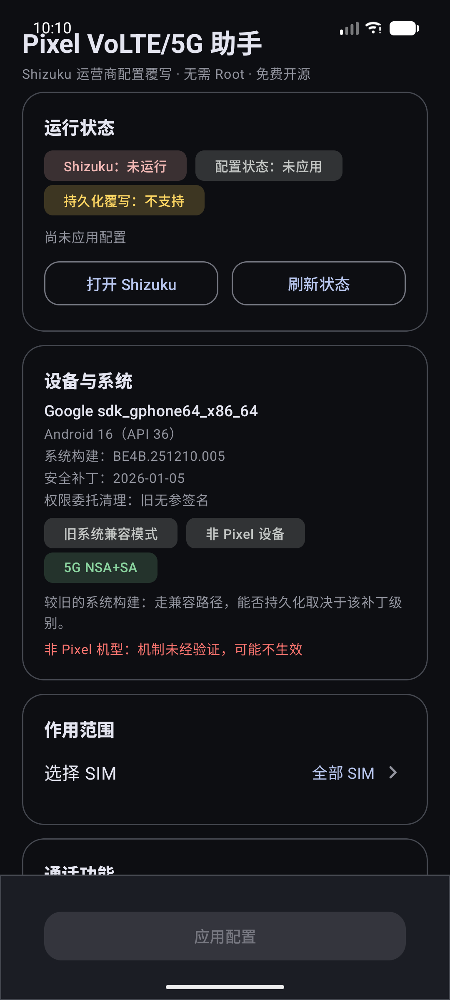

# Pixel VoLTE/5G 助手（Shizuku）

无需 Root，通过 [Shizuku](https://shizuku.rikka.app/zh-hans/) 在 Google Pixel（含 **Pixel 9 Pro XL**）上开启 **VoLTE / VoNR / 5G（NSA+SA）/ VoWiFi** 等运营商能力。

适用于 Google 未对当地运营商做 5G/VoLTE 认证的情况（例如国行外版 Pixel 插大陆卡没有 VoLTE/5G 开关）。

| 主界面 | 功能开关 | SIM 选择 | 深色模式 |
| --- | --- | --- | --- |
|  |  |  |  |

## 安装

推荐走**应用内更新**（装一次之后，后续版本都在应用里完成）：

1. 首次安装：[Releases](https://github.com/K1tor/PixelVolte5G/releases/latest) 下载 APK，
   或 `adb install -r PixelVolte5G-debug.apk`；
2. 安装 [Shizuku](https://github.com/RikkaApps/Shizuku/releases)（13.6.0+）并通过无线调试启动；
3. 打开应用，授予 Shizuku 权限与电话权限；
4. 之后有新版本时，应用内「应用更新」卡片会提示，点“下载 → 安装”即可覆盖升级。

> 首次通过应用内更新安装时，Android 会要求允许“安装未知应用”；授权后返回应用会自动继续。

## v1.3 更新内容（适 Android 17 QPR2 / `CP4A.261105.040.A1`）

### 系统兼容

- **权限委托清理双签名兼容**：Android 17 起 `IActivityManager.stopDelegateShellPermissionIdentity()` 换成带 UID 的签名。
  旧实现会在此处抛 `NoSuchMethodError` —— 而此时覆写**其实已经写入成功**，界面却报失败。
  v1.3 运行时先试带 UID 的签名、再回退无参签名（参考 [pixel-volte-patch #472](https://github.com/kyujin-cho/pixel-volte-patch/issues/472)、[PR #487](https://github.com/kyujin-cho/pixel-volte-patch/pull/487)）。
- **写入 / 校验 / 清理三态分离**：清理失败不再把已成功的写入改判为失败，只作为诊断信息展示。
- **按 SIM 回读校验**：写入后回读版本指纹与关键键值，确认真的落到该 subId 的配置里，而不是只看调用有没有抛异常。
- **编译目标提升**：`compileSdk` / `targetSdk` 35 → 36，版本 1.2 → 1.3（versionCode 4）。
- **构建号与兼容分级**：界面展示系统构建号、安全补丁、实际探测到的委托清理签名，并给出“已适配 / 按兼容路径 / 旧系统”分级。

### 界面优化

- **主操作固定底部**：长列表滚动时“应用配置”始终可见，不再需要滚回顶部。
- **状态即真相**：状态胶囊 + “上次应用”真实回执（成功数/总数、是否持久化、清理是否异常）。
- **设备卡片**新增系统构建号、安全补丁、委托清理签名与兼容判定。
- **开关行改为系统设置同构样式**：主标题 + 说明 + 右侧开关，整行可点。
- **“5G 组网模式 / 选择 SIM”改为设置项行**：右侧直接显示当前值，点开才进选择弹窗。
- **高级功能折叠**：跨 SIM、UT、恢复默认收进默认折叠的分区，减少首屏噪音。
- **配色规范化**：状态色改为主题资源并补齐 `values-night`，深色模式下对比度正常。

### 行为修正

- **关闭开关现在真的生效**：`overrideConfig` 是合并语义，旧实现只写入“打开”的键，
  关掉开关后上一次写入的 `true` 仍在。v1.3 对每个开关都写入显式值（关闭 = `false`）。
- **新增“恢复默认配置”**：以 `overrideConfig(null)` 丢弃整份覆写。
  注意这与“把所有开关关掉”不同，是彻底撤销的唯一方式。
- **不再无条件报成功**：旧版固定等 3 秒就弹“配置已写入”。现改为等待真实回执（最多 12 秒），
  区分成功 / 部分成功 / 失败 / 无回执四种结果。

### 应用内更新

- 应用内检查更新 → 下载 → 校验 SHA-256 → 系统安装器覆盖升级，见下文「应用内更新」。

## 应用内更新

应用内置「应用更新」卡片，不必每次去网页找 APK：

1. 打开应用即**静默检查**一次 GitHub Releases；有新版会弹窗（版本号 + 更新说明），无新版就在卡片里显示“已是最新版本”。
2. 点「下载」在应用内直接下载，带进度条，可随时取消。
3. 下载完成后点「安装」，交给系统安装器覆盖升级（首次会引导你打开“允许安装未知应用”）。

实现细节，便于排查：

- 版本比较基于 Release 的 `tag_name`（如 `v1.3`），与 `versionName` 做语义化比较。
- **下载优先走 `api.github.com` 的附件端点**，失败再退回 `github.com` 的下载地址：
  国内网络常见 `github.com` 不可达而 `api.github.com` 可用的情形，旧实现会在这里报 `Connection reset`。
  每个地址自动重试一次。
- 若 Release 附件带 `digest`（GitHub 会给出 `sha256:...`），下载后**校验 SHA-256**，不一致立即删除，不会安装错误文件。
- 安装通过 `FileProvider` 把 `cache/update/` 里的 APK 以 `content://` 交给系统安装器，不写公共存储。
- **升级连续性**：从 v1.2 起的所有 release 都由同一张 Android Debug 证书签名
  （SHA-256 `ff3c8aa8…`），所以应用内更新可以直接覆盖安装；若你手上是自行改签名的版本，系统会拒绝覆盖，需卸载重装。
- 更新说明来自 Release 正文，应用内只做 Markdown 精简后**当纯文本显示**，不执行其中任何内容。

> 若一直提示网络失败：通常是 `api.github.com` 也被拦截，此时用「在浏览器中打开」跳转发布页手动下载即可。

## 原理

本应用与知名的 Pixel IMS（vvb2060 v3.1 方案）同一原理：

1. Shizuku 以 shell（ADB）身份运行服务，本应用通过 Shizuku 获得 shell 权限；
2. 应用通过 `IActivityManager.startInstrumentation`（以 shell 身份发起）在自己的进程内启动一个 Instrumentation；
3. Instrumentation 内先调用 `startDelegateShellPermissionIdentity` 把 shell 的权限身份（`MODIFY_PHONE_STATE` 等）委托给应用 uid，再调用隐藏 API `CarrierConfigManager.overrideConfig` 写入**运营商配置覆写（carrier config override）**：
   - `carrier_volte_available_bool` → VoLTE 可用 + 设置里显示“增强 4G LTE 模式”开关
   - `carrier_nr_availabilities_int_array = [NSA, SA]` → 开放 5G NSA/SA
   - `vonr_enabled_bool` → VoNR（5G 语音）
   - `carrier_wfc_ims_available_bool` → WiFi 通话
   - 以及 VT / 跨 SIM / UT 等
4. 同时通过 `ITelephony.setImsProvisioningInt` 打开 IMS 语音开通位（部分运营商在开通层拦截 VoLTE）。

> 为什么不能直接用 shell 调 overrideConfig？2025 年 10 月的 Android 安全补丁（CVE-2025-48617）封堵了 shell 身份直接调用该接口，所以必须走“Instrumentation + 权限委托”这条链路。

覆写支持两种模式（运行时按系统补丁级别自动选择）：

| 模式 | 行为 |
| --- | --- |
| 持久化覆写 | 重启后仍然生效（系统允许时自动使用） |
| 非持久化覆写 | 立即生效，但重启或“电话”进程重启后失效，需重新点一次“应用配置” |

## 针对最新系统（Android 17 QPR2，如 CP4A.261105.040.A1）的须知

- 该构建属于 Android 17 QPR2（2026-11 Pixel Drop），补丁级别已包含 CVE-2025-48617 修复：
  老的 `setprop persist.dbg.*` 方法与“shell 直接调 overrideConfig”均不可用，本应用已按 v3.1 委托机制实现。
- **委托清理改用带 UID 的签名**：v1.3 已做双签名兼容。若你在旧版本上遇到
  “报错但配置其实已生效”，就是这个问题。
- **持久化覆写大概率显示“不支持”**：最新补丁封堵了持久化路径，覆写为非持久化——重启后需重新应用。
  Shizuku 重连时应用会自动恢复覆写；建议保持 Shizuku 开机自启（无线调试开关保持开启）。
- Shizuku 请使用 **13.6.0 以上**版本（`CP3A.261005.005` 的实测记录即使用 13.6.0）。
- 系统大版本更新后可能再次失效（历史上 2025-10、2025-12、2026-10 更新都断过）：
  在 Shizuku 中**停用服务并重新授权**，再重新“应用配置”。
  参见 [Pixel IMS issue #423](https://github.com/kyujin-cho/pixel-volte-patch/issues/423)。
- **5G 已开启但不注册**：把应用内“5G 组网模式”切为**仅 SA**（`carrier_nr_availabilities_int_array` 仅含 SA），
  重新应用并重启。部分运营商在 NSA+SA 组合下 NR 无法注册，这是社区验证过的解法。
- Google Play 系统更新（Mainline）不涉及 `com.android.phone`/CarrierConfigLoader（随 OTA 更新），对本机制无影响。
- 如果覆写已确认写入但 IMS 仍不注册（`OUT_OF_SERVICE`），问题在 radio / eUICC / 运营商侧，
  不要反复切换覆写开关 —— 参见 [pixel-volte-patch #475](https://github.com/kyujin-cho/pixel-volte-patch/issues/475)。

## 支持机型

应用会自动识别机型并按能力启用/禁用功能开关：

| 机型 | 5G | VoNR | 说明 |
| --- | --- | --- | --- |
| Pixel 6 / 6a / 6 Pro 及之后全部 Tensor 机型 | NSA+SA | ✅ | 完整支持（含 9 系列、Fold、a 系列） |
| Pixel 5 / 5a / 4a (5G) | NSA | ❌ | 无 SA 语音能力 |
| Pixel 4 / 4a / 3 系列 | ❌ | ❌ | 5G / VoNR 开关自动停用 |
| Pixel Tablet（tangorpro） | - | - | 无蜂窝模块，工具不可用 |
| 非 Pixel 设备 | 视情况 | 视情况 | 机制未经验证，仍可尝试 |

系统版本兼容：Android 12（API 31）起可用——A13+ 走“Instrumentation + shell 权限委托”路径；
Android 12 设备自动回退为以 shell 身份直调 `ICarrierConfigLoader`。

## 环境要求

- Pixel 设备（Pixel 3 及以后；Tensor 机型体验最佳），Android 12+
- [Shizuku](https://github.com/RikkaApps/Shizuku/releases)（Play 商店或 GitHub 安装），
  通过**无线调试**启动（无需电脑），或 ADB 启动
- Android 11+ 的“无线调试”开发者选项

## 使用步骤

1. 安装并打开 Shizuku → 按引导开启“无线调试”并启动 Shizuku 服务；
2. 安装本应用，打开后授予 Shizuku 权限（弹窗），并允许“电话权限”；
3. 在“作用范围”里选择要作用的 SIM（默认全部）；
4. 按需开关功能（默认全开），较少用的在“高级功能”里；
5. 点击底部 **应用配置**，等待真实回执；
6. 开关一次飞行模式（或重启），到 **设置 → 网络和互联网 → SIM 卡** 确认
   “增强 4G LTE 模式”“5G”等开关已出现；
7. VoLTE/5G 图标未出现时：确认运营商套餐已开通 VoLTE/5G，稍等几分钟让 IMS 注册。

> 应用内 Shizuku 连接成功后会自动应用一次配置（开机自启 Shizuku 的情况下也能自动恢复非持久化覆写）。

## 构建

```bash
# Android Studio 直接打开，或命令行：
./gradlew :app:assembleDebug
# 产物：app/build/outputs/apk/debug/app-debug.apk
```

- AGP 8.7.0 / Gradle 8.9 / Kotlin 2.0.21 / compileSdk 36 / targetSdk 36 / minSdk 31
- 依赖：`dev.rikka.shizuku:api|provider:13.1.5`、`org.lsposed.hiddenapibypass:hiddenapibypass:6.1`
- `:stub` 模块是编译期桩（compileOnly，不打包），运行时直接使用系统真实类
- 国内网络构建慢时，可把 `settings.gradle.kts` 里的 `GoogleMaven` 仓库换成
  `https://maven.aliyun.com/repository/google`、`mavenCentral()` 换成
  `https://maven.aliyun.com/repository/public`

## 项目结构

```
app/src/main/java/com/zt/volte5g/
  ShizukuProvider.kt   # Shizuku 集成：binder 接收、startInstrumentation 发起、版本指纹探测
  PrivilegedProcess.kt # Instrumentation：shell 身份委托 + CarrierConfig 覆写 + 回读校验 + 结果回执
  Delegation.kt        # 委托建立/释放的运行时双签名兼容（Android 17 关键点）
  SystemCompat.kt      # 构建号识别、委托签名探测、兼容分级
  Hidden.kt            # HiddenApiBypass 封装（豁免隐藏 API 限制）
  Keys.kt              # CarrierConfig 键名 / IMS 常量 / 偏好键（字面量，规避 @hide）
  MainActivity.kt      # 界面：状态、设备、SIM、开关、高级区、真实回执
  Updater.kt           # 应用内更新：查 release、多地址下载、SHA-256 校验、FileProvider 安装
  UpdateController.kt  # 更新状态机（后台线程 + 主线程回调）
  MarkdownLite.kt      # 把 Release 说明精简为可读纯文本
stub/                  # IActivityManager / ITelephony / ServiceManager 等编译期桩
```

## 常见问题

- **应用后没有变化**：先开关一次飞行模式；仍不行就重启。非持久化模式在重启后需重新“应用配置”。
- **“持久化覆写：不支持”**：系统是最新安全补丁，持久化路径被封堵，只能非持久化。
- **提示“已提交，但未全部成功”**：看弹窗里的原因。常见是某张 SIM 被系统拒绝，
  或 Shizuku 委托未建立 —— 重新授权后重试。
- **VoLTE 开关出现但打不通电话**：VoLTE 需要运营商开通
  （大陆：发送短信或去营业厅开通 VoLTE）；另外确认 5G/VoLTE 套餐正常。
- **清除覆写**：点“高级功能 → 恢复默认配置”，应用后再开关一次飞行模式。
  只把开关关掉不会丢弃已经写入的其他键。
- **抓日志**：`adb logcat -s Volte5G` 可看到每次的 `子网结果 / 持久化 / 清理` 诊断行。
- **安全提示**：本应用仅修改本机运营商配置，不会联网、不需要 Root；所有写入在 Shizuku 授权范围内进行。

## 免责声明

本项目利用 Android 调试接口修改设备侧运营商配置，仅供学习与个人设备使用。
由此产生的任何后果（包括但不限于功能异常、保修问题）由使用者自行承担。
请遵守当地法律与运营商条款。
